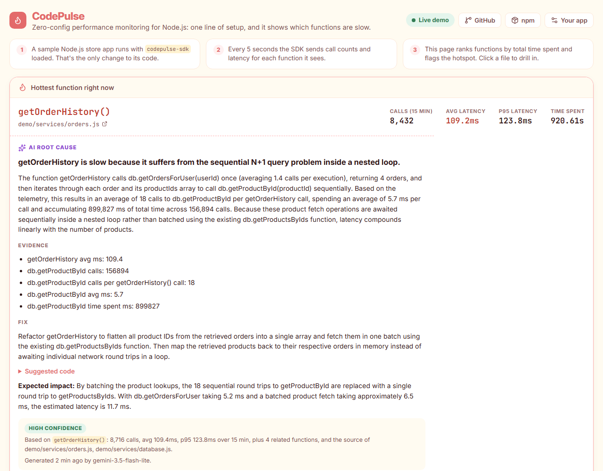
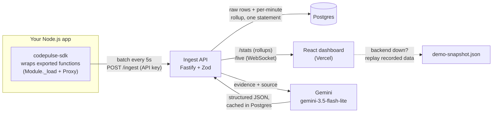

# CodePulse

**Zero-config performance monitoring for Node.js, with AI root-cause analysis.**

Add one line to a Node.js app and CodePulse times every exported function, finds the one costing the most time, and has an LLM explain why it is slow and how to fix it, based on the measured numbers and the actual source code.

**Live demo:** https://codepulse-codepulse-dashboard.vercel.app/ (no sign-up, no setup; it opens on live data from a sample app)



## What you're looking at

The demo runs a small online-store backend ([`demo/`](demo)) with `codepulse-sdk` loaded and steady simulated traffic.

1. **Telemetry:** every 5 seconds the SDK sends each function's call count and a latency histogram.
2. **Hotspot:** the dashboard ranks functions by total time spent (calls × average latency) and flags the top one. Here that's `getOrderHistory()`, at about 110 ms per call.
3. **AI root cause:** Gemini receives the hotspot's numbers, the numbers for the functions it calls, and the source of the files involved. It returns a diagnosis, the evidence, a fix and an expected impact. The panel shows exactly which data the model was given.
4. **Ask about the code:** a chat in the same sidebar answers questions such as "Why is getOrderHistory slow?" or "Which functions are never called?" from the live telemetry and the source. The suggested questions are pre-answered, so they reply instantly.

The demo bottleneck is deliberate: `getOrderHistory()` awaits one `getProductById()` per line item, about 18 sequential lookups per request (an N+1 query). The source doesn't label it; the model has to find it from the code and telemetry. We ran the fix it suggested against the demo code: latency went from about 110 ms to about 12 ms, matching its 11.7 ms estimate.

## Use it in your app

```bash
npm install codepulse-sdk
```

```js
// First line of your entry file, before other requires
require('codepulse-sdk').init({ ingestUrl: 'https://your-server/ingest', apiKey: process.env.CODEPULSE_API_KEY, projectId: 'my-app', githubRepo: 'you/your-repo' });
```

Then open the dashboard, click **Your app**, and enter your server URL, key, repo and project ID.

## Architecture



| Part | Path | Stack |
|---|---|---|
| SDK | [`codepulse-sdk/`](codepulse-sdk) | TypeScript, no dependencies |
| Ingest API | [`codepulse-ingest/`](codepulse-ingest) | Fastify, Zod, postgres.js, Gemini API |
| Dashboard | [`codepulse-dashboard/`](codepulse-dashboard) | React, Vite, Recharts |
| Demo app | [`demo/`](demo) | Node.js |

**How it works**

- **Instrumentation.** The SDK hooks Node's module loader. Every local CommonJS module's exported functions are wrapped in a `Proxy` that times each call, including async ones. Functions that are exported but never called are reported too, so dead code shows up.
- **Batching.** Calls are aggregated in memory and sent every 5 s as one batch per process, with a 20-bucket latency histogram per function.
- **Storage.** Each batch is written as raw rows and also upserted into a per-minute rollup table in one SQL statement. The dashboard only reads the rollups, so query cost doesn't grow with event volume. p95 is estimated from the merged histograms.
- **AI analysis.** The server builds the prompt from measured data only, including precomputed call ratios such as "18 calls per `getOrderHistory()` call", so the model doesn't do arithmetic. It requests JSON that matches a schema, retries once if the suggested code calls functions that don't exist in the source, and caches the result. The public demo regenerates at most every 30 days, so visitors never spend model credits. Other projects need the API key and are rate-limited.
- **Reliability.** `GET /health` reports database status and recent demo traffic. If the backend is unreachable, the dashboard switches within seconds to a clearly labelled recording of real data ([`scripts/record-demo-snapshot.mjs`](scripts/record-demo-snapshot.mjs)) and goes back to live data when the backend returns.

## Performance

Measured locally on a laptop; method and caveats in [docs/benchmarks.md](docs/benchmarks.md).

- **Ingest:** about 1,500 batched payloads/s (about 26,000 rows/s) on one Node.js process with Postgres, 0 errors, no rows lost. About 480/s when every batch targets the same project.
- **Queries:** the dashboard's p95 query takes 2 ms at p50 and 6 ms at p99 over about 1 million stored rows (about 100 million function calls).

## Run it locally

Requires Docker and Node.js 20+ with pnpm.

```bash
git clone https://github.com/Ramya-Shah/CodePulse.git
cd CodePulse
cp .env.example .env          # optional: add GEMINI_API_KEY for AI analysis
docker compose up -d --build  # Postgres + ingest API (:3000) + demo traffic
pnpm install
pnpm --filter codepulse-dashboard dev   # http://localhost:5173
```

Other useful commands:

```bash
node scripts/load-test.mjs http://localhost:3000 local-dev-key 30 50 50   # ingest load test
node scripts/record-demo-snapshot.mjs http://localhost:3000 60            # refresh the replay data
```

### Configuration

| Variable | Where | Purpose |
|---|---|---|
| `INGEST_API_KEY` | ingest | Key SDKs send in `x-api-key`; required for writes and for reading non-demo projects |
| `DATABASE_URL`, `DATABASE_SSL` | ingest | Postgres connection (TLS on by default; `false` for a local container) |
| `GEMINI_API_KEY`, `GEMINI_MODEL` | ingest | AI analysis and chat; leave the key empty to disable them |
| `GEMINI_CHAT_MODELS`, `CHAT_DAILY_LIMIT`, `CHAT_RATE_LIMIT_PER_10_MIN` | ingest | Chat model fallback order (default `gemini-3.5-flash-lite,gemini-3.6-flash`), daily cap on model calls (500), per-IP limit (12) |
| `DEMO_PROJECT_ID`, `DEMO_REPO`, `DEMO_PATH_PREFIX` | ingest | The one project anyone can read without a key |
| `GITHUB_TOKEN` | ingest | Optional; raises the GitHub rate limit for the file tree |
| `VITE_API_URL` | dashboard build | Public URL of the ingest API |

Secrets live only in the server environment (`.env` is gitignored). The dashboard bundle contains no keys.

## Limitations

- Instruments CommonJS modules loaded with `require`. ES modules and non-exported inner functions are not traced.
- p95 values are histogram estimates, not exact percentiles.
- AI output can vary between runs. The demo shows one reviewed analysis rather than regenerating on every visit.
- Free-typed chat questions depend on Gemini's response time, which ranged from 3 to 60 seconds during testing. Suggested questions are cached.
- The benchmarks above come from a single laptop, not a production deployment.

## Links

- **Live demo:** https://codepulse-codepulse-dashboard.vercel.app/
- **npm:** https://www.npmjs.com/package/codepulse-sdk
- **Source:** https://github.com/Ramya-Shah/CodePulse
